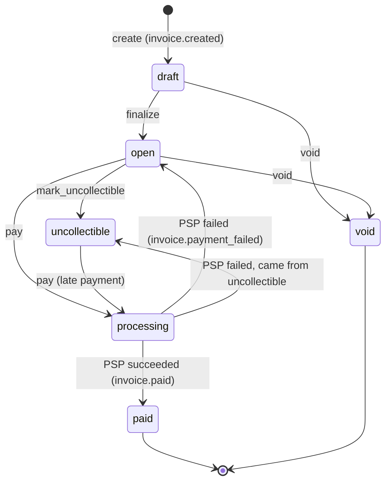

# Design

```
client ─▶ invoice-service ──HTTP, 5s timeout──▶ mock-psp
            │ API handlers ──┐
            │ reconciler ────┼──▶ Postgres (state + outbox)
            │ webhook worker ┘
            └── signed POST ──▶ merchant endpoint (webhook-receiver in the demo)
```

## 1. Data model

App-generated **UUIDv7** primary keys: time-ordered (B-tree friendly, double as the pagination cursor) and non-enumerable. Money is `BIGINT` cents. Statuses are `TEXT + CHECK`: enum-level integrity, and adding a state is a constraint swap rather than `ALTER TYPE`.

| Table | Key columns / constraints | Indexes | At 100x |
|---|---|---|---|
| businesses | name | PK | — |
| api_keys | prefix, key_hash (SHA-256), revoked_at | unique(prefix) | in-memory key cache, short TTL |
| customers | name, email (not unique, as in Stripe) | unique(business_id, id) | — |
| invoices | status, pre_payment_status, total_cents > 0, due_date; **FK (business_id, customer_id) → customers** | (business_id, status, id) | partition by business; replica for lists |
| invoice_line_items | `CHECK amount = qty × unit` | (invoice_id, position) | — |
| payment_attempts | status pending/unknown/succeeded/failed, psp_ref | **partial unique(invoice_id) WHERE in flight**; **WHERE succeeded** | shard reconciler by id range |
| idempotency_keys | PK(business_id, key), request_hash, **response_body BYTEA**, attempt id, expires_at | unique(attempt id) | time-partition, drop old partitions |
| webhook_events | type, payload (outbox) | (business_id, id) | CDC → Kafka/SQS instead of polling |
| webhook_deliveries | per event×endpoint: status, attempts, next_attempt_at | (next_attempt_at) WHERE pending | per-endpoint concurrency caps |

Why this shape:
- The composite FK makes cross-tenant invoices impossible in the schema, not just in handlers.
- The partial unique indexes stop two in-flight or two successful attempts per invoice, even if the code has a bug.
- `BYTEA` keeps replayed bodies byte-identical; JSONB reorders keys.
- One delivery row per endpoint means a slow endpoint never delays another.

## 2. Invoice state machine



- **Terminal:** `paid` and `void`.
  - `uncollectible` is deliberately not terminal. A write-off is an accounting call, and a late payment is good news (Stripe agrees).
  - `processing` makes "money may be in flight" queryable. While an invoice is in it, it can't be voided or written off.
- **Reversible:** only `processing → open/uncollectible`, on failure.
  - The previous status is saved by the same UPDATE that enters `processing`: `SET status='processing', pre_payment_status = status`. (The right-hand side of SET reads the old row.)
  - It's durable, so the reconciler can restore it after a crash.
- **Rejection:**
  - `state_machine.rs` is a pure `transition(from, action)` function with an exhaustive unit-tested table.
  - SQL guards (`WHERE status = ANY($allowed)`) are derived from it, so code and database can't disagree.
  - If 0 rows match, a scoped `SELECT` picks 404 or **409 `invalid_state_transition`** with `{current_status, action}`.

## 3. Payment correctness & failure modes

`POST /invoices/{id}/pay` runs in four steps:
1. **Idempotency lookup.**
2. **Tx1**, one transaction:
   - claim the key,
   - `UPDATE invoices SET status='processing' WHERE … status IN ('open','uncollectible')`,
   - insert a `pending` attempt.
3. **The PSP call**, with no transaction or lock held. The attempt id is the PSP idempotency key.
4. **Settle** through `resolve()`, shared with the reconciler.

**Mechanism: a status-conditional UPDATE**, backed by the partial unique indexes. Postgres re-evaluates the WHERE clause after waiting on the row lock, so exactly one transaction wins. The alternatives:
- `SELECT FOR UPDATE` takes more statements for the same result, and holding it across the PSP call would block for 5 s.
- Advisory locks leave no durable record of an in-flight payment after a crash.
- SERIALIZABLE adds retry loops for no extra guarantee.

**(a) Simultaneous pays.**
- One request moves the invoice `open → processing` and charges.
- The other's UPDATE matches 0 rows, so it rolls back (releasing its key) and gets **409**.
- The test fires 20 parallel requests and checks for exactly one 200, nineteen 409s, and one PSP charge.

**(b) PSP timeout.**
- After 5 s the client gives up. The attempt becomes `unknown`, the invoice stays `processing`, and the endpoint returns **202**. The status change and storing the 202 on the key happen in one transaction.
- The **reconciler** polls unresolved attempts older than 10 s with `GET /charges/{attempt_id}`. When the PSP settles (about 30 s), it marks the invoice `paid` and emits `invoice.paid`.
- The caller learns the result from the webhook or `GET /invoices/{id}`. A same-key retry keeps returning 202 by design, so a replay never contradicts the first answer.
- Anything other than a clear `succeeded`/`failed` is handled the same way: 4xx/5xx, connection refused, an unreadable body, or "processing". We never guess.

**(c) PSP succeeded, we crashed before persisting.**
- The attempt is still `pending` and the key `in_progress`, so a retry gets 409, not a second charge.
- The reconciler looks up the attempt id, finds it succeeded, marks the invoice paid, and stores the final 200 on the key, which is still `in_progress`.
- **No double charge**: the invoice is still `processing`, so no new attempt can start, and the PSP is idempotent on the attempt id.
- `resolve()` only updates attempts still `pending`/`unknown`. If the handler and reconciler race, the loser updates 0 rows and does nothing, so there's no duplicate `invoice.paid`.

**(d) Key reused with a different body.** The hash covers method, path (and so the invoice) and the canonical body. A mismatch returns **422 `idempotency_key_reused`** and the stored response is untouched. The hash is checked before the in-progress check, so this is 422 even while the first request is running.

**(e) Pay on `paid`.** With a new key, the response is **409** (`current_status: paid`) and the PSP is never called. With the original key, the original 200 is replayed.

**Startup-checked timings:**
- The PSP not-found grace (60 s) must be greater than the PSP timeout (5 s). A 404 only proves "never charged" once our request can't still be in flight.
- The reconciler's minimum age (10 s) must be at least the PSP timeout, so it doesn't poll attempts the handler is still waiting on.

**Assumption:** "404 after the grace period means never charged" holds for the mock, which records charges before acting. Real PSPs don't guarantee this; see §7.

## 4. Webhooks

- **Signing:**
  - Header `Dodo-Signature: t=<unix>,v1=hex(HMAC-SHA256(secret, "{t}.{raw_body}"))`.
  - Secrets are per endpoint, generated by the server and shown once.
  - Receivers compare in constant time and reject `|now − t| > 300 s`. Because `t` is inside the MAC, a captured body can't be replayed later.
- **Decoupled:**
  - The state change and its outbox rows (`webhook_events` plus one delivery per endpoint) commit in **one transaction**.
  - The API never waits on delivery, and an event exists if and only if its state change committed.
- **Worker:**
  - Claims up to 20 due rows with a **60 s lease** (`FOR UPDATE SKIP LOCKED`, committed before any HTTP), so no lock is held during network calls and several replicas are safe.
  - Posts with a 10 s timeout and doesn't follow redirects.
  - If a worker crashes, the lease expires and the row is resent without counting an attempt. That makes delivery **at-least-once**, so receivers dedupe on `event.id`.
- **Retries:** 1 try plus 8 retries, at +10 s, 30 s, 2 m, 10 m, 30 m, 1 h, 3 h and 6 h (about 10.7 h), with ±20 % jitter. Any 2xx counts as delivered.
- **After retries run out:** the delivery is marked `dead` and logged. Businesses recover missed events with `GET /v1/events?type=…&starting_after=…` or by re-reading invoices.

## 5. API keys

- **Format:** `sk_<prefix8>_<secret32>`, base62 from the OS random source (about 190 bits).
- **Storage:** the prefix in plaintext for lookup, plus SHA-256 of the whole key, compared in constant time. Slow hashes protect low-entropy passwords; here they would only add latency.
- **Transmission:** `Authorization: Bearer`, over TLS in production. Unknown, revoked and malformed keys all get the same 401.
- **Rotation:** `POST /api_keys`, deploy the new key, then `DELETE /api_keys/{id}`. Revocation takes effect on the next request.
- **Blast radius:** one business's full API. No other tenant is reachable, because every query is scoped by `business_id`. There are no scopes yet.

## 6. What I cut, and why

1. **Refunds and partial payments.** They need new states, a refunds table, and a balance instead of a total. The attempt and outbox machinery would carry over.
2. **Webhook redelivery endpoint; `invoice.voided`/`finalized` events.** `GET /events` already covers recovery, and each event is one line to add.
3. **Draft editing and overdue/dunning.** `due_date` is informational; dunning needs a scheduler and a policy.
4. **Rate limits, key scopes, `last_used_at`.** `last_used_at` costs a write per request.
5. **Stale idempotency-key takeover.** Claiming the key inside Tx1, plus the reconciler, made it unnecessary.

## 7. Production readiness gaps

1. **Observability and alerting.** Alerts on attempts stuck in `unknown` past N minutes (an unreachable PSP keeps the key at 409), on `dead` deliveries, and on PSP latency and errors, plus traces across API → PSP → webhook. Today there are structured logs with request ids.
2. **Abuse and safety.**
   - Per-key rate limiting.
   - SSRF filtering of webhook URLs (private IP ranges, DNS rebinding).
   - KMS-encrypted webhook secrets.
   - An audit log of key and manual state changes.
3. **PSP realism.**
   - Void or cancel by idempotency key before reopening after a 404, instead of trusting the grace period.
   - Durable PSP state.
   - Refunds and dunning.
